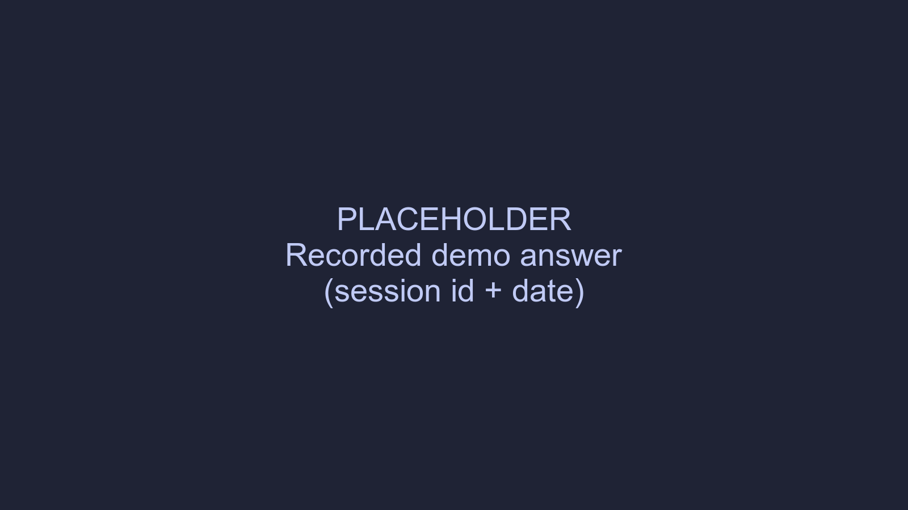

# Inside Coding Agents

## Context, Memory, and What Survives Between Sessions

Vladislav Ramazaev · AI Native Amsterdam · 25 November 2026

<style>
  .pet { display: none !important; }
  .talk-footer { position: fixed; right: 2.2rem; bottom: 2.6rem; z-index: 40; font-family: "IBM Plex Mono", ui-monospace, monospace; font-size: 0.7rem; letter-spacing: 0.04em; opacity: 0.55; pointer-events: none; }
  @media print { .talk-footer { display: none !important; } }
</style>
<div class="talk-footer">vladar107</div>

<!-- notes: [0:30 · running 0:30] No agenda, no bio. One sentence: "I want to start by asking my coding agent about work I did months ago." Then switch to the terminal. -->

---

## A question about old work

> Did we ever decide how to keep sessions whose transcript files were deleted? What were the options, and when was that?

*Not in this conversation. Not in `CLAUDE.md`. Not in the README. Never implemented.*

**→ Claude Code, live**

<!-- notes: [2:30 · running 3:00] LIVE DEMO. Switch to the prepared Claude Code window, paste the exact rehearsed prompt. While it runs: "Fresh session. The project files do not contain the answer." Expected answer: today the reindex prunes deleted files and the index cannot rebuild a transcript; option one was an archive copy of raw transcripts, rejected; option two, a setting that stops pruning and flags orphaned rows with a degraded transcript from index rows; the open tension was rebuilds, best effort versus export before discard, with export recommended. Source: Claude Code session 939387c7 in the Claudescope repo, 23 to 27 July 2026. If the demo fails: press End for the recorded answer (last slide), then O and click slide 3 to come back. If the agent answers from CLAUDE.md only, ask it to check the session history. -->

---

## Did it remember, or did it retrieve?

| What we saw | Where it lives |
| --- | --- |
| The decision and the alternatives | A session file from months earlier |
| The date and the session id | The file name and one record inside it |
| Nothing of this in the current context | Until the agent went and searched |

**Having the history is not the same as remembering it.**

<!-- notes: [1:30 · running 4:30] The whole talk is this distinction. The agent did not remember; it had a tool that could search its own past and used it. Next: what is actually in that file. -->

---

## The raw record

`~/.claude/projects/<project>/939387c7-….jsonl`, two lines of it:

```json
{ "type": "assistant", "uuid": "1040ecb1…", "parentUuid": "304de08c…",
  "timestamp": "2026-07-27T08:34:49.838Z", "gitBranch": "main", "cwd": "~/src/claudescope",
  "message": { "content": [
    { "type": "thinking", "thinking": "", "signature": "CAISojsKiAEIEBgC…" } ] } }

{ "type": "assistant", "uuid": "52551e44…", "parentUuid": "1040ecb1…",
  "timestamp": "2026-07-27T08:35:06.946Z", "gitBranch": "main", "cwd": "~/src/claudescope",
  "message": { "content": [
    { "type": "text", "text": "Yes — that's feasible while keeping the current design…" }
  ] } }
```

- **`parentUuid`**: records form a tree, not a list; reasoning and answer are separate records
- **`timestamp`, `gitBranch`, `cwd`**: the decision carries its own provenance
- **`thinking` is empty**; only the `signature` is on disk

<!-- notes: [2:00 · running 6:30] Show the unreadable full line in the terminal first (grep 52551e44 <session>.jsonl | head -c 2000), then this slide does the explaining. Real records from the demo session, Claude Code 2.1.220; cwd shortened, ids truncated. Fields not on the slide (sessionId, usage, model, version, requestId) are on every record too; mention them only if asked. -->

---

## The same session, reconstructed


- Records grouped into **turns**
- Tool calls paired with their **results**
- The **compaction boundary** made visible
- Search across every session on the machine

<!-- notes: [2:00 · running 8:30] LIVE: switch to the Claudescope browser window already open on this session (http://127.0.0.1:4317/sessions/939387c7-8a25-4e80-9b7c-6106932bbe6d). Scroll to the turn with the decision. The slide is the fallback. Instrument, not subject: "a viewer I built to read these files; the point is that the file was readable all along, just not by humans." -->

---

## What the harness keeps to rebuild a session

| Needed to rebuild | Where it is on disk |
| --- | --- |
| Messages and tool calls | `user` and `assistant` records; a tool result is a `user` record pointing at the call |
| Provenance | `timestamp`, `cwd`, `gitBranch`, `sessionId` on every record |
| Large tool output | Spilled to `<session-id>/tool-results/*.txt`; the model saw a 2 KB preview |
| Harness-injected context | `attachment` records: environment, reminders, hook output |
| Housekeeping | Titles, mode changes, PR links, file snapshots |

In one real 6,682-record session, **about a third** was conversation.

<!-- notes: [2:30 · running 11:00] One investigation: what must be preserved to reconstruct a useful session? Two surprises: tool results arrive as user messages, and the transcript is not self-contained: the 40 KB the agent read is in a sidecar file. Subagents have their own transcripts under <session-id>/subagents/; mention only if asked. -->

---

## Compaction: the record survives, the context does not

```json
{ "type": "system", "subtype": "compact_boundary",
  "parentUuid": null, "logicalParentUuid": "2f40…",
  "compactMetadata": { "trigger": "auto",
    "preTokens": 1000964, "postTokens": 17382, "durationMs": 172436 } }

{ "type": "user", "isCompactSummary": true, "isVisibleInTranscriptOnly": true,
  "message": { "content": "This session is being continued from a previous
     conversation that ran out of context. Summary: 1. Primary Request and Intent: …" } }
```

- **1,000,964 tokens in, 17,382 out**, in just under three minutes
- The summary arrives as a **`user` message**; the model reads it, it did not write it for itself
- The parent chain is cut; `logicalParentUuid` remembers where it was. **Everything before it is still on disk.**

<!-- notes: [2:00 · running 13:00] Real numbers from one auto-compaction (Claude Code 2.1.25x). "Nothing before this line is in the model's context anymore, except what the summary chose to keep. All of it is still in the file." -->

---

## How the next request is rebuilt

```text
session.jsonl ──▶ drop housekeeping ──▶ cut at last compact_boundary ──▶ messages[] ──▶ model request
      ▲                                                                       ▲              │
      │                       instructions + memory + skills ─────────────────┘              │
      └────────────────────── new records appended ◀────────────────────────────────────────┘
```

- The stored session is the **durable record** a resumed context is rebuilt from
- Instruction and memory files enter on a **separate path**, under their own scope and loading rules
- What the model sees is the **intersection** of the two, never the whole file

<!-- notes: [1:30 · running 14:30] Bridge to memory. The same records feed both "what the model sees now" and "what can be searched later". Memory enters on a separate path; the rest of the talk is about what should be allowed onto it. The exact replay rules are inferred from the records, not from documentation: say "roughly" and move on. -->

---

## Codex and Pi, where they differ

| Question | Claude Code | Codex CLI | Pi |
| --- | --- | --- | --- |
| **How is a session structured?** | Linked JSONL records, `parentUuid` tree | Typed rollout events: `session_meta`, `turn_context`, `response_item` | Threaded messages, `id` / `parentId` |
| **What reasoning state remains?** | Signed opaque state, empty `thinking` | Encrypted opaque state, `encrypted_content` | Plaintext `thinking`, optional `thinkingSignature` |
| **How is earlier context replaced?** | `compact_boundary` + summary message | `compacted` with `replacement_history` | `compaction` entry: `summary`, `firstKeptEntryId` |

<!-- notes: [2:00 · running 16:30] Three questions, one slide. Codex: a turn is spread across several rollout items and the reasoning is an opaque encrypted blob. Pi: threaded records; keeps the thinking text on disk next to the provider signature, and a compaction entry that names the first kept record (from the pi-coding-agent 0.85.1 type definitions and docs; a locally recorded session is still on the list). Do not tour the formats. -->

---

## Opaque reasoning is still sensitive

Four things that are not the same:

1. The **final answer**
2. A **visible summary** of the reasoning
3. The **full internal reasoning**
4. A **signed or encrypted blob** returned to the harness so the next turn can continue

- On disk, Claude Code and Codex keep **4**, not 3, in the sessions inspected
- Recent research suggests encryption alone should not be treated as sanitisation (arXiv 2608.09867)
- **Strip opaque blocks before sharing a transcript.**

<!-- notes: [2:00 · running 18:30] Two minutes, no more. The paper is a pointer, not a topic. Exact wording of the claim to be re-checked against the abstract before the talk. Then straight to memory. -->

---

## Session history versus persistent memory

| State | Next turn, same session | New session |
| --- | --- | --- |
| **Current context** | Yes | No |
| **Compacted summary** | Yes | Only if resumed |
| **Stored transcript** | Only through replay or search | Only through search |
| **Instructions and memory** | Yes | Usually yes, subject to scope and loading rules |

The demo answer came from the **third row**. Most "give the agent memory" work targets the **fourth**.

<!-- notes: [2:00 · running 20:30] Two explicit columns: next turn and new session. The stored transcript is the only row that is complete and the only row that needs an action to reach. -->

---

## Memory files and their provenance

```text
~/.claude/CLAUDE.md                        global instructions
<repo>/CLAUDE.md, <repo>/AGENTS.md         project instructions
~/.claude/projects/<project>/memory/       agent-written facts
  ├── MEMORY.md                            index, one line per fact
  └── preserve-deleted-sessions.md         one fact
~/.codex/memories/MEMORY.md                Codex: scoped task-group notes
```

```yaml
name: preserve-deleted-sessions
description: Deleted transcripts stay in the index behind a setting; decided 2026-07-27 over copying raw files
metadata:
  type: project
  originSessionId: 939387c7-8a25-4e80-9b7c-6106932bbe6d
```

- Claude Code memory carries **`originSessionId`**; Codex notes carry `scope`, `applies_to`, `rollout_path`
- Provenance exists. **Whether anything reads it is another matter.**

<!-- notes: [2:00 · running 22:30] Real file shapes; the fact is what the demo session would have produced had it been saved, no such file exists. Provenance is what makes the rest possible: you can go from a memory fact back to the session that produced it. Pi has no home-directory memory store as far as inspected. Frontmatter delimiters omitted because Deckrun splits slides on them. -->

---

## More knowledge, or more influence

| | Stored session | Persistent memory |
| --- | --- | --- |
| Size | A million tokens dropped at one compaction | A few hundred tokens per fact |
| Loaded | When resumed or searched | **Before the first prompt, when in scope** |
| Written by | The run itself | A judgement about the run |
| A wrong entry costs | One bad answer, once | The same bias, **every session it is loaded into** |

> A transcript has more knowledge. A memory file has more influence.

<!-- notes: [1:30 · running 24:00] The key sentence of the talk. Compare the two sizes: a million tokens nobody rereads versus a few hundred tokens everybody rereads. -->

---

## How a correct note becomes poison

1. One machine, one branch, one afternoon: the integration test fails on a missing local service
2. The agent finds a workaround that is **valid right there**
3. It saves the observation as project memory:

> Skip `PaymentsIntegrationTests`; they are flaky and unrelated to feature work.

4. The machine, the branch, and the missing service all go away
5. Whenever that memory is loaded, the note shapes the agent **before it looks at the current situation**

*The observation was true. The scope was lost.*

<!-- notes: [3:00 · running 27:00] Non-adversarial on purpose. Nobody attacked anything. Other examples if asked: "The API is unavailable, use a mock", "Disable this validation in development", "Never edit this generated file", "Use this absolute path". Each was correct once. -->

---

## Rules for memory that is loaded automatically

- **Review agent-written memory like code.** It runs on every session it is loaded into.
- **Label the kind.** Instruction, decision, observation, hypothesis: today the loader treats them alike.
- **Keep the provenance**: date, session id, machine, branch
- **Give workarounds an expiry**: "until the service is back", "until the branch merges"
- **Supersede, do not accumulate.** A stale fact is worse than no fact.
- **Instructions are the strongest candidates for unconditional loading.** Decisions and observations usually need scope, or retrieval.

> The more automatically information enters context, the stronger its evidence and scope must be.

<!-- notes: [2:00 · running 29:00] The blockquote is the central rule; everything above it is a consequence. -->

---

## Retrieve the history instead of memorising the conclusion


This is what the opening demo did.

- **Resume** a known session
- **Grep** the raw transcripts
- **Index** once, search the index
- Expose history through **MCP**
- Teach the agent **when** to look back

**Indexing consistently reduced retrieval effort. Accuracy gains depended on the corpus.**

<!-- notes: [3:00 · running 32:00] One chart, one result, one caveat. Chart to build: latency and cost prominent (pilot: 2.8x faster, 2.3x cheaper), accuracy shown with uncertainty, pilot and pooled labelled separately (+9 pp in the pilot, near zero pooled). Do not read the numbers aloud unless asked; the sentence on the slide is the claim. Multi-session synthesis is where it gets interesting. -->

---

## Three things to take home

1. Coding agents **preserve far more state** than their visible conversation suggests
2. Persistent memory is **small but repeatedly influential**
3. Searchable history keeps the **evidence** without loading every past conclusion

> Before building more memory for your coding agent, inspect what it already stores, review what it keeps injecting into context, and make the rest safely searchable.

<div style="display:flex; justify-content:center; gap:5rem; margin-top:1rem;">
  <figure style="margin:0; text-align:center;">
    
    <figcaption style="font-size:0.8rem; opacity:0.75;">deck, sources, tools</figcaption>
  </figure>
  <figure style="margin:0; text-align:center;">
    
    <figcaption style="font-size:0.8rem; opacity:0.75;">linkedin.com/in/vladar107</figcaption>
  </figure>
</div>

<!-- notes: [2:00 · running 34:00] Return to the opening answer: the agent did not remember, it retrieved, and the record was good enough to retrieve from. Closing line, then questions. Left QR: the repo README carries every link (deck PDF, Claudescope, recall-bench, Linktree, sources). -->

---

## Backup: the recorded answer



<!-- notes: [APPENDIX · only if the live demo fails] Reached with End. Read the answer aloud, point at the session id and the date, say it was recorded the day before with the same prompt. Then O (overview) and click slide 3 to continue. -->
