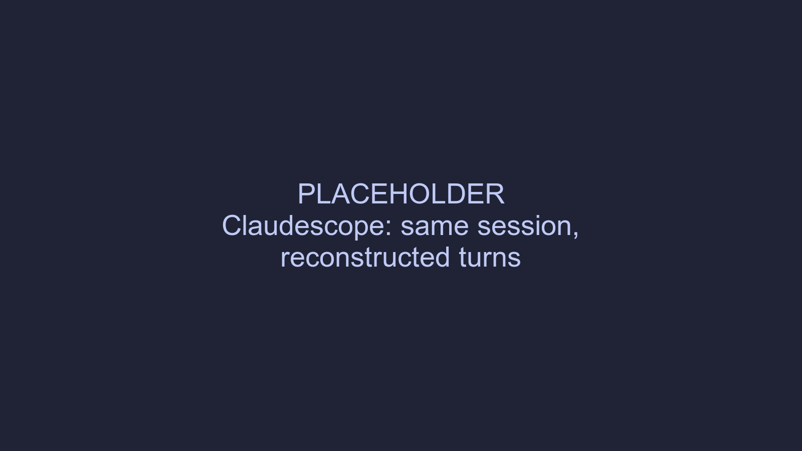

<link rel="stylesheet" href="assets/talk.css">
<div class="l-title"></div>

# Inside Coding Agents

## Context, memory, and what survives between sessions

<div class="byline"><span>Vladislav Ramazaev</span><span>AI Native Amsterdam · 25 November 2026</span></div>

<!-- notes: [0:30 · running 0:30] No agenda, no bio. One sentence: "I want to start by asking my coding agent about work I did months ago." Then switch to the terminal. -->

---

## One evening in August

*A fresh session. No notes, no `CLAUDE.md`, no memory.*

<div class="live">live · Claude Code</div>

<!-- notes: [2:30 · running 3:00] LIVE DEMO. Announce, do not show, the question: "Three months ago I spent an evening trying to get a mute button for my audio interface. Let's ask my agent what came of it." Switch to the prepared Claude Code window (started with scripts/demo.sh claude, cwd ~/src) and paste the prompt from the clipboard: "Did we ever work out how to toggle my Audient iD14 mic from Raycast? What options did we look at, what did we end up recommending, and when was that?" While it runs (about 30 seconds): "Fresh session. Nothing in this folder contains the answer." Expected answer: the iD14 exposes no mute or volume controls to macOS, so Raycast's mic toggles cannot work; the iD mixer's Cut only mutes the monitor mix; a true global mute needs a virtual device plus a router that always runs (BlackHole with LadioCast, or the micbridge prototype), which I rejected; so the recommendation was per-app: the Teams and Zoom Raycast extensions, Cmd+D in Meet. Dates 27 and 28 August 2026, session bdd809e6. Point at the tool calls scrolling past: the history skill, claudescope search, claudescope session. If the demo fails: say what it would have found (the four bullets above), then move on to slide 3; slides 4 and 5 still show the real record. If the agent starts searching files instead, say "check our session history". -->

---

## Did it remember, or did it retrieve?

| What we saw | Where it lives |
| --- | --- |
| The decision and the alternatives | A session file from three months earlier |
| The date and the session id | The file name and the records inside it |
| Nothing of this in the current context | Until the agent went and searched |

**Having the history is not the same as remembering it.**

<!-- notes: [1:30 · running 4:30] The whole talk is this distinction. The agent did not remember; it had a tool that could search its own past and used it. Next: what is actually in that file. -->

---

## The raw record

<div class="live">live · terminal</div>

`~/.claude/projects/-Users-…-src/bdd809e6-….jsonl`, two lines of it:

```json
{ "type": "assistant", "uuid": "a913a34d…", "parentUuid": "76826dfd…",
  "timestamp": "2026-08-28T12:06:45.145Z", "cwd": "~/src/micbridge",
  "message": { "content": [
    { "type": "thinking", "thinking": "", "signature": "CAISuA4KpwEIERgC…" } ] } }

{ "type": "assistant", "uuid": "2b5b3b6a…", "parentUuid": "a913a34d…",
  "timestamp": "2026-08-28T12:06:51.088Z", "cwd": "~/src/micbridge",
  "message": { "content": [
    { "type": "text", "text": "…my recommendation: take the per-app route…" } ] } }
```

- **`parentUuid`**: records form a tree, not a list; reasoning and answer are separate records
- **`timestamp`, `cwd`**: provenance travels with the decision; that folder is gone, the record is not
- **`thinking` is empty**; only the `signature` is on disk

<!-- notes: [2:00 · running 6:30] LIVE, real files first, in the terminal: ls ~/.claude/projects, then ls -lh the bdd809e6 file inside the -src folder (one file, one session), then grep 2b5b3b6a <file> | head -c 1500 to show one unreadable line, then jq it (commands in demo/README.md). Come back to this slide to explain the three fields. Real records from the demo session, Claude Code 2.1.247; cwd shortened, ids and text truncated. Fields not on the slide (sessionId, gitBranch, usage, model, version, requestId) are on every record too; mention them only if asked. -->

---

## The same session, reconstructed

<div class="live">live · Claudescope</div>



- Records grouped into **turns**
- Tool calls paired with their **results**
- Tokens and cost **per turn**
- Search across every indexed session

<!-- notes: [2:00 · running 8:30] LIVE: switch to the Claudescope browser window already open on this session (scripts/demo.sh open, http://127.0.0.1:4318/sessions/bdd809e6-a231-42a7-8c6f-aec2d256d14a). It is the isolated demo instance: nine personal sessions, no work projects. Scroll to the last turn, the recommendation. The slide is the fallback. Instrument, not subject: "a viewer I built to read these files; the point is that the file was readable all along, just not by humans." -->

---

## What the harness keeps to rebuild a session

| Needed to rebuild | Where it is on disk |
| --- | --- |
| Messages and tool calls | `user` and `assistant` records; a tool result is a `user` record pointing at the call |
| Provenance | `timestamp`, `cwd`, `gitBranch`, `sessionId` on every record |
| Large tool output | Spilled to `<session-id>/tool-results/*.txt`; the model saw a 2 KB preview |
| Harness-injected context | `attachment` records: environment, reminders, hook output |
| Housekeeping | Titles, mode changes, PR links, file snapshots |

In one real 6,682-record session, **about a third** was conversation.

<!-- notes: [2:30 · running 11:00] One investigation: what must be preserved to reconstruct a useful session? Two surprises: tool results arrive as user messages, and the transcript is not self-contained: the 40 KB the agent read is in a sidecar file. Subagents have their own transcripts under <session-id>/subagents/; mention only if asked. Frame for the mixed audience before the table: "You do not need to remember the formats, only three facts: the transcript is more complete than the chat, context is rebuilt, compaction removes context but not history." The next two slides are those facts. -->

---

## Compaction: the record survives, the context does not

<div class="live">live · Claudescope</div>

```json
{ "type": "system", "subtype": "compact_boundary",
  "parentUuid": null, "logicalParentUuid": "2f40…",
  "compactMetadata": { "trigger": "auto",
    "preTokens": 1000964, "postTokens": 17382, "durationMs": 172436 } }

{ "type": "user", "isCompactSummary": true, "isVisibleInTranscriptOnly": true,
  "message": { "content": "This session is being continued from a previous
     conversation that ran out of context. Summary: 1. Primary Request and Intent: …" } }
```

- **1,000,964 tokens in, 17,382 out**, in just under three minutes
- The summary arrives as a **`user` message**; the model reads it, it did not write it for itself
- The parent chain is cut; `logicalParentUuid` remembers where it was. **Everything before it is still on disk.**

<!-- notes: [2:00 · running 13:00] LIVE in Claudescope: `npm run demo -- open compaction`, the summary turn of a manual /compact (90,283 → 25,942 tokens, 39 s), then the last turn, answered from the summary. Then back here: the numbers on the slide are from a bigger, automatic compaction. Real numbers from one auto-compaction (Claude Code 2.1.25x). "Nothing before this line is in the model's context anymore, except what the summary chose to keep. All of it is still in the file." -->

---

## How the next request is rebuilt

```text
session.jsonl ──▶ drop housekeeping ──▶ cut at last compact_boundary ──▶ messages[] ──▶ model request
      ▲                                                                       ▲              │
      │                       instructions + memory + skills ─────────────────┘              │
      └────────────────────── new records appended ◀────────────────────────────────────────┘
```

- The stored session is the **durable record** a resumed context is rebuilt from
- Instruction and memory files enter on a **separate path**, under their own scope and loading rules
- What the model sees is the **intersection** of the two, never the whole file

*Documented: "the last compaction's summary, the messages that compaction left unsummarized, and every message since." Simplified diagram.*

<!-- notes: [1:30 · running 14:30] Bridge to memory. The same records feed both "what the model sees now" and "what can be searched later". Memory enters on a separate path; the rest of the talk is about what should be allowed onto it. The compaction cut is documented (code.claude.com/docs/en/sessions); whether attachments and reminders are replayed on resume is not, so if asked: "not documented, and I would not rely on it". -->

---

## Codex and Pi, where they differ

| Question | Claude Code | Codex CLI | Pi |
| --- | --- | --- | --- |
| **How is a session structured?** | Linked JSONL records, `parentUuid` tree | Typed rollout events: `session_meta`, `turn_context`, `response_item` | Threaded messages, `id` / `parentId` |
| **What reasoning state remains?** | Signed opaque state, empty `thinking` | Encrypted opaque state, `encrypted_content` | Plaintext `thinking`, optional `thinkingSignature` |
| **How is earlier context replaced?** | `compact_boundary` + summary message | `compacted` with `replacement_history` | `compaction` entry: `summary`, `firstKeptEntryId` |

<!-- notes: [2:00 · running 16:30] Three questions, one slide. Codex: a turn is spread across several rollout items and the reasoning is an opaque encrypted blob. Pi: threaded records; keeps whatever thinking text the provider returns on disk next to the provider signature, and a compaction entry that names the first kept record (observed in a pi 0.85.1 session: with the OpenAI provider the thinking field held the reasoning summary and the opaque state sat in thinkingSignature; the full-text case with an Anthropic model is still from the type definitions only). Do not tour the formats. -->

---

## Opaque reasoning is still sensitive

Four things that are not the same:

1. The **final answer**
2. A **visible summary** of the reasoning
3. The **full internal reasoning**
4. A **signed or encrypted blob** returned to the harness so the next turn can continue

- On disk, Claude Code and Codex keep **4**, and almost never 3, in the sessions inspected
- A 2026 paper decoded encrypted reasoning blocks from public session logs: **367 PII artifacts and 182 credentials** from 315k blocks (arXiv 2608.09867)
- **Encryption is not sanitisation. Strip opaque blocks before sharing a transcript.**

<!-- notes: [2:00 · running 18:30] Two minutes, no more. The paper is a pointer, not a topic: they fed the encrypted blocks back into a weaker model from the same provider, across Anthropic, OpenAI and Google, and read the reasoning out. Do not explain the method beyond that sentence. "Almost never 3": recent Claude Code versions occasionally keep a short thinking text (a few of hundreds of blocks); the signature is always there. If asked about Pi: in the recorded session it kept 2 and 4, the summary and the opaque state, because that is what the OpenAI provider returns. Then straight to memory. -->

---

## Session history versus persistent memory

| State | Next turn, same session | New session |
| --- | --- | --- |
| **Current context** | Yes | No |
| **Compacted summary** | Yes | Only if resumed |
| **Stored transcript** | Only through replay or search | Only through search |
| **Instructions and memory** | Yes | Usually yes, subject to scope and loading rules |

The demo answer came from the **third row**. Most "give the agent memory" work targets the **fourth**.

<!-- notes: [2:00 · running 20:30] Two explicit columns: next turn and new session. The stored transcript is the only row that is complete and the only row that needs an action to reach. -->

---

## Memory files and their provenance

<div class="live">live · Claudescope</div>

```text
~/.claude/CLAUDE.md                        global instructions
<repo>/CLAUDE.md, <repo>/AGENTS.md         project instructions
~/.claude/projects/<project>/memory/       agent-written facts
  ├── MEMORY.md                            index, one line per fact
  └── stage-demo-isolation.md             one fact
~/.codex/memories/MEMORY.md                Codex: scoped task-group notes
```

```yaml
name: stage-demo-isolation
description: Until the talk on 2026-11-25, live demos run only through scripts/demo.sh …
metadata:
  node_type: memory
  type: project
  originSessionId: 920985f5-3019-44aa-92ce-3f4a6af261d2
  modified: 2026-10-29T09:39:16.542Z
```

**`originSessionId` leads back to the session. Whether anything reads it is another matter.**

<!-- notes: [2:00 · running 22:30] LIVE in Claudescope: Memory page, project amsterdam-ai-native-talk, open stage-demo-isolation. Real file: Claude Code wrote it on 2026-10-29 in the session that built this deck; the harness stamped originSessionId, node_type and modified. Point at originSessionId, then say you will not open that session: it is full of your day job. "Provenance points somewhere, but not always somewhere you can show." It also carries an expiry, the 25th of November; that is rule four on slide 15. Codex notes carry the same idea as scope, applies_to and rollout_path. Real file shapes; the fact on the slide is the real file, trimmed. Provenance is what makes the rest possible: you can go from a memory fact back to the session that produced it. Pi has no home-directory memory store as far as inspected. Frontmatter delimiters omitted because Deckrun splits slides on them. -->

---

## More knowledge, or more influence

| | Stored session | Persistent memory |
| --- | --- | --- |
| Size | A million tokens dropped at one compaction | A few hundred tokens per fact |
| Loaded | When resumed or searched | **Index before the first prompt**, facts on demand |
| Written by | The run itself | A judgement about the run |
| A wrong entry costs | One bad answer, once | The same bias, **every session it is loaded into** |

> A transcript has more knowledge. A memory file has more influence.

<!-- notes: [1:30 · running 24:00] The key sentence of the talk. Compare the two sizes: a million tokens nobody rereads versus a few hundred tokens everybody rereads. Facts if asked: Claude Code auto-memory is on by default in local sessions; the first 200 lines or 25 KB of MEMORY.md load at every session start, and topic files are read on demand (code.claude.com/docs/en/memory). Codex memories are off by default and enabled with memories = true under [features]. -->

---

## How a correct note becomes poison

1. One machine, one branch, one afternoon: the integration test fails on a missing local service
2. The agent finds a workaround that is **valid right there**:

> On this branch, while the local payments service is down, skip `PaymentsIntegrationTests`.

3. It saves the observation as project memory:

> Skip `PaymentsIntegrationTests`; they are flaky and unrelated to feature work.

4. The machine, the branch, and the missing service all go away
5. Whenever that memory is loaded, the note shapes the agent **before it looks at the current situation**

*The observation was true. The scope was lost.*

<!-- notes: [3:00 · running 27:00] Non-adversarial on purpose. Nobody attacked anything. Other examples if asked: "The API is unavailable, use a mock", "Disable this validation in development", "Never edit this generated file", "Use this absolute path". Each was correct once. -->

---

## Rules for memory that is loaded automatically

- **Review agent-written memory like code.** It runs on every session it is loaded into.
- **Label the kind.** Instruction, decision, observation, hypothesis: today the loader treats them alike.
- **Keep the provenance**: date, session id, machine, branch
- **Give workarounds an expiry**: "until the service is back", "until the branch merges"
- **Supersede, do not accumulate.** A stale fact is worse than no fact.
- **Instructions are the strongest candidates for unconditional loading.** Decisions and observations usually need scope, or retrieval.

> The more automatically information enters context, the stronger its evidence and scope must be.

<!-- notes: [2:00 · running 29:00] The blockquote is the central rule; everything above it is a consequence. -->

---

## Retrieve the history instead of memorising the conclusion


- **Resume** a known session
- **Grep** the raw transcripts
- **Index** once, search the index
- Expose history through **MCP**
- Teach the agent **when** to look back

**Indexing cut retrieval effort on every corpus. The accuracy gain shrank once more corpora came in.**

<!-- notes: [3:00 · running 32:00] One chart, one result, one caveat. Read the top panel: on every corpus, raw search took more than twice as long and cost about twice as much. Then the bottom: the pilot's +9 points shrank to about +2 pooled, and that interval crosses zero. Say it plainly: "Indexing makes retrieval cheaper. I cannot show it makes it more accurate." Disclose: "I wrote both the benchmark and the indexer." If asked: 3 corpora, 87 questions, 229 runs per arm; one pooled corpus is the pilot's own machine; the largest per-category gain was multi-session synthesis, +7 pp, still not clearly above zero. Figures computed from recall-bench submissions at commit 66dc060 (assets/charts/recall-bench.csv). -->

---

## Three things to take home

1. Coding agents **preserve far more state** than their visible conversation suggests
2. Persistent memory is **small but repeatedly influential**
3. Searchable history keeps the **evidence** without loading every past conclusion

> Before building more memory for your coding agent, inspect what it already stores, review what it keeps injecting into context, and make the rest safely searchable.

<div style="display:flex; justify-content:center; gap:5rem; margin-top:1rem;">
  <figure style="margin:0; text-align:center;">
    
    <figcaption style="font-size:0.8rem; opacity:0.75;">deck, sources, tools</figcaption>
  </figure>
  <figure style="margin:0; text-align:center;">
    
    <figcaption style="font-size:0.8rem; opacity:0.75;">linkedin.com/in/vladar107</figcaption>
  </figure>
</div>

<!-- notes: [2:00 · running 34:00] Return to the opening answer: the agent did not remember, it retrieved, and the record was good enough to retrieve from. Closing line, then questions. Left QR: the repo README carries every link (deck PDF, Claudescope, recall-bench, Linktree, sources). -->

