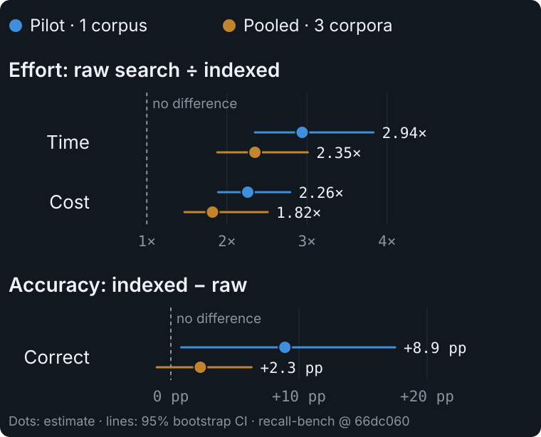

<link rel="stylesheet" href="assets/talk.css">
<div class="l-title"></div>

# Inside Coding Agents

## Context, memory, and what survives between sessions

<div class="byline"><span>Vladislav Ramazaev</span><span>AI Native Amsterdam · 25 November 2026</span></div>

<!-- notes: [0:30 · running 0:30]
No agenda, no bio.
SAY: "I want to start by asking my coding agent about work I did months ago."
GO TO: the Claude Code window. -->

---

## One evening in August

*A fresh session. No notes, no `CLAUDE.md`, no memory.*

<div class="live">live · Claude Code</div>

<!-- notes: [2:30 · running 3:00] LIVE · Claude Code window (scripts/demo.sh claude)
SAY: "Three months ago I spent an evening trying to get a mute button for my audio interface. Let's ask my agent what came of it."
DO: paste question 1 from the clipboard: "Did we ever work out how to toggle my Audient iD14 mic from Raycast? What options did we look at, what did we end up recommending, and when was that?"
WHILE IT RUNS: "Fresh session. Nothing in this folder contains the answer." Point at the tool calls: history skill, claudescope search, claudescope session.
EXPECT: no mute control on the device · the mixer's Cut only mutes the headphones · a virtual router needs a background process, rejected · so mute per app (Teams, Zoom, Cmd+D in Meet) · 27 and 28 August.
IF IT SEARCHES FILES: type "check our session history".
IF IT FAILS: say the four points yourself and go on. -->

---

## Did it remember, or did it retrieve?

| What we saw | Where it lives |
| --- | --- |
| The decision and the alternatives | A session file from three months earlier |
| The date and the session id | The file name and the records inside it |
| Nothing of this in the current context | Until the agent went and searched |

**Having the history is not the same as remembering it.**

<!-- notes: [1:30 · running 4:30]
TOPIC: remember or retrieve. The whole talk is this distinction.
SAY: it did not remember. It had a tool that searches its own past, and it used it.
NEXT: what is actually in that file. -->

---

## The raw record

<div class="live">live · terminal</div>

`~/.claude/projects/-Users-…-src/bdd809e6-….jsonl`, two lines of it:

```json
{ "type": "assistant", "uuid": "a913a34d…", "parentUuid": "76826dfd…",
  "timestamp": "2026-08-28T12:06:45.145Z", "cwd": "~/src/micbridge",
  "message": { "content": [
    { "type": "thinking", "thinking": "", "signature": "CAISuA4KpwEIERgC…" } ] } }

{ "type": "assistant", "uuid": "2b5b3b6a…", "parentUuid": "a913a34d…",
  "timestamp": "2026-08-28T12:06:51.088Z", "cwd": "~/src/micbridge",
  "message": { "content": [
    { "type": "text", "text": "…my recommendation: take the per-app route…" } ] } }
```

- **`parentUuid`**: records form a tree, not a list; reasoning and answer are separate records
- **`timestamp`, `cwd`**: provenance travels with the decision; that folder is gone, the record is not
- **`thinking` is empty**; only the `signature` is on disk

<!-- notes: [2:00 · running 6:30] LIVE · terminal (commands in demo/README.md)
DO: ls ~/.claude/projects · ls -lh the bdd809e6 file · grep one line · the same line through jq.
SAY: one file, one session. One line, unreadable. The same line, readable.
BACK TO THE SLIDE: three fields. parentUuid: a tree, not a list. thinking: empty text plus a signature. cwd and timestamp on every record.
Other fields only if asked. -->

---

## The same session, reconstructed

<div class="live">live · Claudescope</div>


- Records grouped into **turns**
- Tool calls paired with their **results**
- Tokens and cost **per turn**
- Search across every indexed session

<!-- notes: [2:00 · running 8:30] LIVE · Claudescope (scripts/demo.sh open)
DO: scroll to the last turn, the recommendation.
SAY: "A viewer I built to read these files. The file was readable all along, just not by humans."
The slide is the fallback. -->

---

## What the harness keeps to rebuild a session

| Needed to rebuild | Where it is on disk |
| --- | --- |
| Messages and tool calls | `user` and `assistant` records; a tool result is a `user` record pointing at the call |
| Provenance | `timestamp`, `cwd`, `gitBranch`, `sessionId` on every record |
| Large tool output | Spilled to `<session-id>/tool-results/*.txt`; the model saw a 2 KB preview |
| Harness-injected context | `attachment` records: environment, reminders, hook output |
| Housekeeping | Titles, mode changes, PR links, file snapshots |

In one real 6,682-record session, **about a third** was conversation.

<!-- notes: [2:30 · running 11:00]
TOPIC: what must be kept to rebuild a session.
SAY FIRST: "You don't need to remember the formats, only three facts: the transcript is more complete than the chat, context is rebuilt, compaction removes context but not history."
TWO SURPRISES: tool results arrive as user messages · the 40 KB the agent read sits in a sidecar file, not in the transcript.
Subagent transcripts only if asked. -->

---

## Compaction: the record survives, the context does not

<div class="live">live · Claudescope</div>

```json
{ "type": "system", "subtype": "compact_boundary",
  "parentUuid": null, "logicalParentUuid": "2f40…",
  "compactMetadata": { "trigger": "auto",
    "preTokens": 1000964, "postTokens": 17382, "durationMs": 172436 } }

{ "type": "user", "isCompactSummary": true, "isVisibleInTranscriptOnly": true,
  "message": { "content": "This session is being continued from a previous
     conversation that ran out of context. Summary: 1. Primary Request and Intent: …" } }
```

- **1,000,964 tokens in, 17,382 out**, in just under three minutes
- The summary arrives as a **`user` message**; the model reads it, it did not write it for itself
- The parent chain is cut; `logicalParentUuid` remembers where it was. **Everything before it is still on disk.**

<!-- notes: [2:00 · running 13:00] LIVE · Claudescope (scripts/demo.sh open compaction)
DO: the summary turn of a manual /compact (90,283 → 25,942 tokens, 39 s), then the last turn, answered from the summary.
BACK TO THE SLIDE: these numbers are from a bigger, automatic compaction.
SAY: "Nothing before this line is in the model's context anymore, except what the summary chose to keep. All of it is still in the file." -->

---

## How the next request is rebuilt

<div class="flow"><svg viewBox="0 0 1110 200" role="img" aria-label="The session file is filtered, cut at the last compaction boundary and turned into the message list for the model request; instructions, memory and skills join that list on a separate path; new records are appended back to the session file" style="display:block; width:100%; height:auto; font-family:var(--font-mono); font-size:16px;"><rect x="12" y="20" width="150" height="50" rx="8" fill="none" stroke="var(--text)" stroke-width="1.5"/><text x="87" y="51" text-anchor="middle" fill="var(--text)">session.jsonl</text><rect x="202" y="20" width="195" height="50" rx="8" fill="none" stroke="var(--text)" stroke-width="1.5"/><text x="299.5" y="51" text-anchor="middle" fill="var(--text)">drop housekeeping</text><rect x="437" y="20" width="305" height="50" rx="8" fill="none" stroke="var(--text)" stroke-width="1.5"/><text x="589.5" y="51" text-anchor="middle" fill="var(--text)">cut at last compact_boundary</text><rect x="782" y="20" width="125" height="50" rx="8" fill="none" stroke="var(--text)" stroke-width="1.5"/><text x="844.5" y="51" text-anchor="middle" fill="var(--text)">messages[]</text><rect x="947" y="20" width="150" height="50" rx="8" fill="none" stroke="var(--text)" stroke-width="1.5"/><text x="1022" y="51" text-anchor="middle" fill="var(--text)">model request</text><path d="M166,45 H190" stroke="var(--text)" stroke-width="1.5" fill="none"/><path d="M199,45 l-10,-5.5 v11 z" fill="var(--text)"/><path d="M401,45 H425" stroke="var(--text)" stroke-width="1.5" fill="none"/><path d="M434,45 l-10,-5.5 v11 z" fill="var(--text)"/><path d="M746,45 H770" stroke="var(--text)" stroke-width="1.5" fill="none"/><path d="M779,45 l-10,-5.5 v11 z" fill="var(--text)"/><path d="M911,45 H935" stroke="var(--text)" stroke-width="1.5" fill="none"/><path d="M944,45 l-10,-5.5 v11 z" fill="var(--text)"/><rect x="437" y="98" width="305" height="50" rx="8" fill="var(--accent-soft)" stroke="var(--accent)" stroke-width="1.5"/><text x="589.5" y="129" text-anchor="middle" fill="var(--text)">instructions + memory + skills</text><path d="M746,123 H844.5 V84" stroke="var(--accent)" stroke-width="1.5" fill="none"/><path d="M844.5,73 l-5.5,10 h11 z" fill="var(--accent)"/><path d="M1022,74 V172 H87 V84" stroke="var(--text)" stroke-width="1.5" fill="none" stroke-dasharray="6 5"/><path d="M87,73 l-5.5,10 h11 z" fill="var(--text)"/><rect x="120" y="158" width="230" height="28" fill="var(--mantle)"/><text x="235" y="178" text-anchor="middle" fill="var(--text)">new records appended</text></svg></div>

- The stored session is the **durable record** a resumed context is rebuilt from
- Instruction and memory files enter on a **separate path**, under their own scope and loading rules
- What the model sees is the **intersection** of the two, never the whole file

*Documented: "the last compaction's summary, the messages that compaction left unsummarized, and every message since." Simplified diagram.*

<!-- notes: [1:30 · running 14:30]
TOPIC: the bridge to memory.
SAY: the same records feed "what the model sees now" and "what can be searched later". Memory enters on a separate path. The rest of the talk is about what belongs on it.
IF ASKED whether attachments are replayed on resume: "not documented, and I would not rely on it". -->

---

## Codex and Pi, where they differ

<div class="live">live · Pi · Claudescope</div>

| Question | Claude Code | Codex CLI | Pi |
| --- | --- | --- | --- |
| **How is a session structured?** | Linked JSONL records, `parentUuid` tree | Typed rollout events: `session_meta`, `turn_context`, `response_item` | Threaded messages, `id` / `parentId` |
| **What reasoning state remains?** | Signed opaque state, empty `thinking` | Encrypted opaque state, `encrypted_content` | Plaintext `thinking`, optional `thinkingSignature` |
| **How is earlier context replaced?** | `compact_boundary` + summary message | `compacted` with `replacement_history` | `compaction` entry: `summary`, `firstKeptEntryId` |

<!-- notes: [3:30 · running 18:00] LIVE · Pi window (scripts/demo.sh pi), then Claudescope (scripts/demo.sh open agents)
DO: paste question 2 into Pi: "check our session history with claudescope: why is kitty remote control socket-only in my config and not just yes? what else did we look at back then, and when was that?"
WHILE IT RUNS: Claudescope, one project, the same five prompts in Claude Code, Codex and Pi. Say that it is staged. Open the Pi session, scroll to "Context compacted".
DO NOT open the Codex session.
EXPECT IN PI: a review tool needed a kitty overlay, which needs remote control over a socket · socket-only gives that and still rejects escape codes · 11 August.
SAY: "That decision was made in Claude Code. Pi just read the record."
BACK TO THE SLIDE: Codex: a turn is spread over several items, reasoning is an encrypted blob. Pi: threaded records, thinking text plus signature on disk, a compaction entry that names the first kept record. No format tour.
IF BEHIND: skip the Pi question, show Claudescope only. -->

---

## Opaque reasoning is still sensitive

Four things that are not the same:

1. The **final answer**
2. A **visible summary** of the reasoning
3. The **full internal reasoning**
4. A **signed or encrypted blob** returned to the harness so the next turn can continue

- On disk, Claude Code and Codex keep **4**, and almost never 3, in the sessions inspected
- A 2026 paper decoded encrypted reasoning blocks from public session logs: **367 PII artifacts and 182 credentials** from 315k blocks (arXiv 2608.09867)
- **Encryption is not sanitisation. Strip opaque blocks before sharing a transcript.**

<!-- notes: [2:00 · running 20:00]
Two minutes, no more.
SAY: the paper is a pointer. They fed the encrypted blocks back into a weaker model from the same provider and read the reasoning out. Anthropic, OpenAI and Google.
"Almost never 3": Claude Code rarely keeps thinking text; the signature is always there.
NEXT: straight to memory. -->

---

## Session history versus persistent memory

| State | Next turn, same session | New session |
| --- | --- | --- |
| **Current context** | Yes | No |
| **Compacted summary** | Yes | Only if resumed |
| **Stored transcript** | Only through replay or search | Only through search |
| **Instructions and memory** | Yes | Usually yes, subject to scope and loading rules |

The demo answer came from the **third row**. Most "give the agent memory" work targets the **fourth**.

<!-- notes: [2:00 · running 22:00]
TOPIC: two columns, next turn and new session.
SAY: the stored transcript is the only row that is complete, and the only row that needs an action to reach. -->

---

## Memory files and their provenance

<div class="live">live · Claudescope</div>

```text
~/.claude/CLAUDE.md                        global instructions
<repo>/CLAUDE.md, <repo>/AGENTS.md         project instructions
~/.claude/projects/<project>/memory/       agent-written facts
  ├── MEMORY.md                            index, one line per fact
  └── stage-demo-isolation.md             one fact
~/.codex/memories/MEMORY.md                Codex: scoped task-group notes
```

```yaml
name: stage-demo-isolation
description: Until the talk on 2026-11-25, live demos run only through scripts/demo.sh …
metadata:
  node_type: memory
  type: project
  originSessionId: 920985f5-3019-44aa-92ce-3f4a6af261d2
  modified: 2026-10-29T09:39:16.542Z
```

**`originSessionId` leads back to the session. Whether anything reads it is another matter.**

<!-- notes: [2:00 · running 24:00] LIVE · Claudescope (scripts/demo.sh open memory)
DO: project amsterdam-ai-native-talk, open stage-demo-isolation.
SAY: Claude Code wrote this on 29 October while we built this deck. Point at originSessionId. "I won't open that session, it's full of my day job. Provenance points somewhere, but not always somewhere you can show."
It carries an expiry, 25 November: that is rule four on slide 15.
Codex notes: scope, applies_to, rollout_path. Pi: no memory store. -->

---

## More knowledge, or more influence

| | Stored session | Persistent memory |
| --- | --- | --- |
| Size | A million tokens dropped at one compaction | A few hundred tokens per fact |
| Loaded | When resumed or searched | **Index before the first prompt**, facts on demand |
| Written by | The run itself | A judgement about the run |
| A wrong entry costs | One bad answer, once | The same bias, **every session it is loaded into** |

> A transcript has more knowledge. A memory file has more influence.

<!-- notes: [1:30 · running 25:30]
The key sentence of the talk.
SAY: a million tokens nobody rereads, against a few hundred tokens everybody rereads.
IF ASKED: Claude Code auto-memory is on by default; the first 200 lines or 25 KB of MEMORY.md load at every session start. Codex memories are off by default. -->

---

## How a correct note becomes poison

1. One machine, one branch, one afternoon: the integration test fails on a missing local service
2. The agent finds a workaround that is **valid right there**:

> On this branch, while the local payments service is down, skip `PaymentsIntegrationTests`.

3. It saves the observation as project memory:

> Skip `PaymentsIntegrationTests`; they are flaky and unrelated to feature work.

4. The machine, the branch, and the missing service all go away
5. Whenever that memory is loaded, the note shapes the agent **before it looks at the current situation**

*The observation was true. The scope was lost.*

<!-- notes: [3:00 · running 28:30]
TOPIC: nobody attacked anything. Walk the five steps.
END ON: "The observation was true. The scope was lost."
MORE EXAMPLES IF ASKED: "The API is unavailable, use a mock" · "Disable this validation in development" · "Use this absolute path". Each was correct once. -->

---

## Rules for memory that is loaded automatically

- **Review agent-written memory like code.** It runs on every session it is loaded into.
- **Label the kind.** Instruction, decision, observation, hypothesis: today the loader treats them alike.
- **Keep the provenance**: date, session id, machine, branch
- **Give workarounds an expiry**: "until the service is back", "until the branch merges"
- **Supersede, do not accumulate.** A stale fact is worse than no fact.
- **Instructions are the strongest candidates for unconditional loading.** Decisions and observations usually need scope, or retrieval.

> The more automatically information enters context, the stronger its evidence and scope must be.

<!-- notes: [2:00 · running 30:30]
SAY: the blockquote is the rule. Everything above it follows from it.
Rule four, the expiry: the memory file you just saw had one. -->

---

## Retrieve the history instead of memorising the conclusion



- **Resume** a known session
- **Grep** the raw transcripts
- **Index** once, search the index
- Expose retrieval through **MCP or a skill**
- Teach the agent **when** to look back

**The index answers in half the time. It is not clearly more accurate.**

<!-- notes: [3:00 · running 33:30]
SAY: back at the opening. It did not memorise my decision, it retrieved it.
WAYS: resume · grep · index · MCP or a skill · teach the agent when to look back. "In the first demo that was a skill. In the second one, it was me."
CHART: three questions, the same three bars each time. Time: 62 s against 27 and 30. Cost: 24 cents against 13 and 20, so 45% cheaper through MCP, 15% through the skill. Correct: 93% against 95 and 95, inside the noise.
SAY: "The index makes retrieval faster and cheaper. I can't show it makes it more accurate."
DISCLOSE: "I wrote both the benchmark and the indexer."
MODEL: Claude Sonnet 5 as the agent, Claude Opus 4.8 as the blind judge.
IF ASKED: 3 machines, 87 questions, 229 runs per approach. Accuracy +2.3 points, interval −1.1 to +6.3. An earlier one-machine pilot showed +9. -->

---

## Three things to take home

1. Coding agents **preserve far more state** than their visible conversation suggests
2. Persistent memory is **small but repeatedly influential**
3. Searchable history keeps the **evidence** without loading every past conclusion

> Before building more memory for your coding agent, inspect what it already stores, review what it keeps injecting into context, and make the rest safely searchable.

<!-- notes: [2:00 · running 35:30]
SAY: the agent did not remember, it retrieved, and the record was good enough to retrieve from.
Read the blockquote. Then the next slide. -->

---

## Thank you

<div style="display:flex; align-items:center; gap:4rem; margin-top:1.5rem;">
  <div style="flex:1; line-height:2; font-size:1.35rem;">
    <strong>Vladislav Ramazaev</strong><br>
    <span style="opacity:0.75;">Claudescope</span> · <a href="https://claudescope.ramazaev.dev" style="color:inherit; border-bottom:none; background:none; text-decoration:underline; text-decoration-thickness:1px; text-underline-offset:0.2em;">claudescope.ramazaev.dev</a><br>
    <span style="opacity:0.75;">recall-bench</span> · <a href="https://github.com/vladar107/recall-bench" style="color:inherit; border-bottom:none; background:none; text-decoration:underline; text-decoration-thickness:1px; text-underline-offset:0.2em;">github.com/vladar107/recall-bench</a><br>
    <span style="opacity:0.75;">LinkedIn</span> · <a href="https://www.linkedin.com/in/vladar107" style="color:inherit; border-bottom:none; background:none; text-decoration:underline; text-decoration-thickness:1px; text-underline-offset:0.2em;">linkedin.com/in/vladar107</a><br>
    <span style="opacity:0.75;">Site</span> · <a href="https://ramazaev.dev" style="color:inherit; border-bottom:none; background:none; text-decoration:underline; text-decoration-thickness:1px; text-underline-offset:0.2em;">ramazaev.dev</a>
  </div>
  <figure style="margin:0; text-align:center;">
    
    <figcaption style="font-size:1.05rem; margin-top:0.5rem;"><strong>Slides, sources, links</strong><br><a href="https://github.com/vladar107/amsterdam-ai-native-talk" style="color:inherit; border-bottom:none; background:none; text-decoration:underline; text-decoration-thickness:1px; text-underline-offset:0.2em;">github.com/vladar107/amsterdam-ai-native-talk</a></figcaption>
  </figure>
</div>

<!-- notes: [stays up during questions]
SAY: "Thank you. The code takes you to the slides, the sources and every link. Questions?"
Leave this slide on for the whole Q&A. -->
