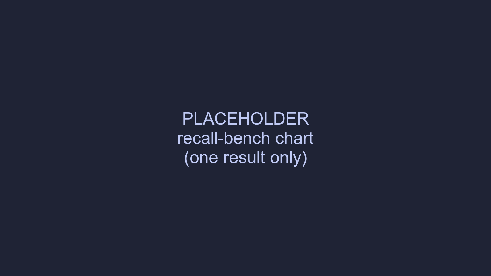

# Inside Coding Agents

## Context, Memory, and What Survives Between Sessions

Vladislav Ramazaev · AI Native Amsterdam · 25 November 2026

<style>
  .pet { display: none !important; }
  .talk-footer { position: fixed; right: 2.2rem; bottom: 2.6rem; z-index: 40; font-family: "IBM Plex Mono", ui-monospace, monospace; font-size: 0.7rem; letter-spacing: 0.04em; opacity: 0.55; pointer-events: none; }
  .print-only { display: none; }
  @media print {
    .talk-footer, .screen-only { display: none !important; }
    .print-only { display: block !important; }
  }
</style>
<div class="talk-footer">vladar107 · claudescope</div>

<!-- notes: [0:30 · Part 1 starts] No agenda, no bio. One sentence: "I want to start with a question to my coding agent about work I did months ago." Then switch straight to the terminal. -->

---

## A question about old work

> Why did we choose DuckDB for this project, what alternatives did we consider, and where was this discussed?

*Nothing about this is in the current conversation, in `CLAUDE.md`, or in the README.*

**→ Claude Code, live**

<!-- notes: [2:00] LIVE DEMO. Switch to the prepared Claude Code window, paste the exact rehearsed prompt. While it runs: "It is a fresh session. The project files do not contain the answer." The agent should return: the decision, the alternatives, the session id and the date. PLACEHOLDER: the DuckDB question is from the brief; replace it with the decision chosen in notes/demo-decision.md. -->

---

## If the demo misbehaves


<!-- notes: [FALLBACK · skip when live works] Screenshot of the rehearsed run. Read the answer aloud, point at the session id and the date. Say that this was recorded yesterday with the same prompt. -->

---

## Did it remember, or did it retrieve?

| What we saw | Where it lives |
| --- | --- |
| The decision and the alternatives | A session from **July 2026** |
| The date and the session id | The file name and one record inside it |
| Nothing in the current context | Until the agent went and searched |

**Historical availability is not the same as memory.**

<!-- notes: [1:30 · end of Part 1 at ~4:00] The whole talk is this distinction. The agent did not "remember"; it had a tool that could search its own past and it used it. For the next 15 minutes: what is actually in that file. -->

---

# Part 2 · Inside a coding-agent session

<!-- notes: [0:15] Section marker. "Claude Code is the main example. Codex and Pi appear where they do something different." -->

---

## Where did this come from? The raw record

`~/.claude/projects/<project>/<session-id>.jsonl`

```json
{"type":"assistant",
 "uuid":"9f2c...","parentUuid":"4b71...",
 "sessionId":"c0ffee12-...","timestamp":"2026-07-14T09:41:03.118Z",
 "cwd":"/work/session-digest","gitBranch":"feat/storage",
 "message":{"role":"assistant","model":"claude-opus-5","content":[
   {"type":"thinking","thinking":"","signature":"EqQBCkYIBRgC..."},
   {"type":"text","text":"Going with DuckDB: JSONL is read in place, no ingest step."}
 ],"usage":{"input_tokens":78,"cache_read_input_tokens":41205,"output_tokens":212}}}
```

- **`parentUuid`** links records into a tree, not a list
- **`thinking` is empty**; only the `signature` survives on disk
- The decision lives in `text`, next to its **date, branch, and working directory**

<!-- notes: [2:00] One record, three fields. Do not read the JSON. "Every line in this file is one JSON object like this. This one is the assistant's answer. Notice what is next to it: when, where, on which branch, and how many tokens it cost." Fixture: demo/fixtures/claude-code/session.jsonl -->

---

## The same session, reconstructed

<iframe class="screen-only" src="http://127.0.0.1:4317/sessions/c0ffee12-0000-4000-8000-000000000000" title="Claudescope: the demo session reconstructed into turns"></iframe>


<!-- notes: [1:30] LIVE: the iframe shows the local Claudescope view of the demo session (start it with `claudescope start` before the talk; PLACEHOLDER session id, replace with the real one). Scroll to the decision turn, then to the compaction boundary. If the frame is blank, open assets/screenshots/claudescope-session.png. Instrument, not subject: "This is a viewer I built to read these files. The point is not the tool; the point is that the file was readable all along, just not by humans." -->

---

## Four layers, four lifetimes

| Layer | What it is | Automatically there next time? |
| --- | --- | --- |
| **Current context** | The messages the model sees right now | Yes |
| **Compacted context** | A lossy summary of earlier work | Yes |
| **Stored session** | The durable JSONL execution record | Only when resumed or searched |
| **Persistent memory** | Selected instructions and conclusions | Loaded into future sessions |

<!-- notes: [1:30] The map for the rest of the talk. The demo answer came from layer 3. Most "give the agent memory" work targets layer 4. Part 2 is about layers 1 to 3; Part 4 comes back to layer 4. -->

---

## Anatomy of one session file

One real session, 6,682 records:

| Record type | Count | Role |
| --- | --- | --- |
| `user` | 1,044 | Prompts **and** tool results |
| `assistant` | 1,757 | Text, thinking, tool calls |
| `attachment` | 1,796 | Harness-injected context: env, reminders, hook output |
| `system` | 110 | Compaction boundaries, turn durations, local commands |
| housekeeping | ~1,975 | Titles, mode changes, PR links, file-history snapshots, queue ops |

- Content blocks inside messages: **874 tool calls, 874 tool results, 658 thinking, 245 text**

<!-- notes: [2:00] "Only about a third of this file is conversation." The rest is what the harness needs to rebuild state: what it injected, what it tracked, what happened to files. Numbers from a real Claude Code 2.1.x session, structure only. -->

---

## Tool calls, results, and what does not fit

```json
{"type":"assistant","uuid":"a1..","message":{"content":[
  {"type":"tool_use","id":"toolu_01X","name":"Bash","input":{"command":"cat HANDOFF.md"}}]}}
{"type":"user","uuid":"b2..","parentUuid":"a1..","sourceToolAssistantUUID":"a1..",
 "message":{"content":[{"type":"tool_result","tool_use_id":"toolu_01X",
   "content":"<persisted-output> Output too large (40.7KB).
              Full output saved to: <session-id>/tool-results/b84yv14jf.txt
              Preview (first 2KB): ..."}]},
 "toolUseResult":{"stdout":"...","interrupted":false}}
```

- A tool result is a **`user`** record pointing back at the call
- Large outputs are **spilled to files** beside the transcript; the model sees a preview
- `toolUseResult` keeps the structured form the harness needs, separate from what the model saw

<!-- notes: [1:30] Two things people miss: tool results arrive as user messages, and the transcript is not self-contained: the 40 KB the agent read is in a sidecar file. "Reconstruction needs the directory, not just the .jsonl." -->

---

## Subagents and sidechains

```text
<project>/
├── <session-id>.jsonl
└── <session-id>/
    ├── tool-results/            spilled outputs
    └── subagents/
        ├── agent-a3de74.jsonl   a full child transcript
        └── agent-a3de74.forked-skill.json
```

- A subagent runs its **own conversation** with its own context window
- The parent transcript only holds the **call and the final report**
- `isSidechain: true` marks records that never entered the main context

<!-- notes: [1:30] Why it matters for memory: the reasoning that produced a subagent's conclusion is in a different file. If you only search the main transcript you will find the conclusion and not the evidence. -->

---

## What compaction changes

```json
{"type":"system","subtype":"compact_boundary","content":"Conversation compacted",
 "parentUuid":null,"logicalParentUuid":"2f40...",
 "compactMetadata":{"trigger":"auto",
   "preTokens":1000964,"postTokens":17382,"cumulativeDroppedTokens":983582,
   "durationMs":172436,
   "preservedSegment":{"headUuid":"0a1f...","anchorUuid":"02aa...","tailUuid":"2f40..."}}}
{"type":"user","isCompactSummary":true,"isVisibleInTranscriptOnly":true,"uuid":"02aa...",
 "message":{"role":"user","content":"This session is being continued from a previous
    conversation that ran out of context. The summary below covers the earlier portion
    of the conversation. Summary: 1. Primary Request and Intent: ..."}}
```

- **1,000,964 tokens in → 17,382 tokens out**, in just under three minutes
- The summary is a **`user` message** the model receives, not something the model wrote for itself
- The **parent chain is cut** (`parentUuid: null`); `logicalParentUuid` remembers where it was

<!-- notes: [2:00] Real numbers from one auto-compaction. 98% of the working context became a summary. "Everything before this line is still on disk. Nothing before this line is in the model's context anymore, except what the summary chose to keep." -->

---

## From records on disk to the next request

```text
session.jsonl ──▶ drop housekeeping ──▶ cut at last compact_boundary ──▶ messages[] ──▶ model request
      ▲                                                                       ▲              │
      │                              CLAUDE.md + memory + skills ─────────────┘              │
      └────────────────────── new records appended ◀────────────────────────────────────────┘
```

- The file is the **source of truth**; the context window is a **view** over it
- `--resume` and `--continue` replay this view; nothing else re-reads the whole file
- Persistent memory enters on the **left side**, every single time

<!-- notes: [1:30] Bridge to Part 4: the same records feed both "what the model sees now" and "what can be searched later". Memory files are on a separate path into the request and they are there on every turn. -->

---

## Codex and Pi, where they differ

| | Claude Code | Codex CLI | Pi |
| --- | --- | --- | --- |
| **Record shape** | Flat records, `parentUuid` tree | Envelopes: `session_meta`, `turn_context`, `response_item`, `event_msg` | Header + threaded `id`/`parentId` records |
| **One turn is** | One `assistant` record per content block | A `message`, `reasoning`, `function_call`, `function_call_output` sequence | `message` records with role `user`, `assistant`, `toolResult` |
| **Reasoning on disk** | `thinking: ""` + `signature` | `summary: []` + `encrypted_content` | plaintext `thinking` + signature *(verify)* |
| **Compaction** | `compact_boundary` + summary `user` message | `compacted` with `replacement_history` and window ids | *(verify)* |
| **Sidecars** | `tool-results/`, `subagents/` | `~/.codex/memories/` summaries per rollout | none seen |

<!-- notes: [2:00 · end of Part 2 at ~19:00] One slide, focused differences only. Codex: a turn is scattered across several rollout items and the reasoning is an opaque encrypted blob. Pi: threaded records, tool results are separate records, and thinking can be stored as text. Do not tour the formats. Rows marked (verify) are open items in notes/verification.md. -->

---

## Reasoning state: four things that are not the same

1. The **final answer**
2. A **visible summary** of the reasoning
3. The **full internal reasoning**
4. A **signed or encrypted blob** handed back to the harness so the next turn can continue

- Claude Code and Codex store only **4**; Pi can store **3** *(verify)*
- Encrypted reasoning blocks have been shown to be **recoverable** (Stealing Reasoning Traces from Proprietary LLM APIs, arXiv 2608.09867)
- **Treat opaque blocks as sensitive session data.** Strip them before sharing a transcript.

<!-- notes: [2:00 · Part 3] Two minutes, no more. The paper is a pointer, not a topic: "opaque is not sanitised". Then move straight to memory. -->

---

# Part 4 · Session history versus persistent memory

<!-- notes: [0:15] Section marker. -->

---

## What is loaded every time

```text
~/.claude/CLAUDE.md                       global instructions
<repo>/CLAUDE.md                          project instructions
<repo>/AGENTS.md                          cross-agent instructions
~/.claude/projects/<project>/memory/      agent-written facts
  ├── MEMORY.md                           index, one line per fact
  └── storage-engine-duckdb.md            one fact, with provenance
~/.codex/memories/MEMORY.md               Codex: scoped task-group notes
~/.codex/memories/raw_memories.md         Codex: per-thread raw notes
```

```yaml
name: storage-engine-duckdb
description: DuckDB is the storage engine; chosen 2026-07-14 over SQLite and Parquet+pandas
metadata:
  type: project
  originSessionId: c0ffee12-0000-4000-8000-000000000000
  modified: 2026-07-14T09:41:40.000Z
```

- Claude Code memory carries **`originSessionId`**; Codex notes carry `scope`, `applies_to`, `rollout_path`
- Pi has **no equivalent home-directory memory store** *(verify)*

<!-- notes: [2:30] Real file shapes, synthetic content. Provenance exists in both harnesses, which is what makes the rest of the talk possible: you can go from a memory back to the session that produced it. Frontmatter delimiters omitted because Deckrun splits slides on them. -->

---

## A transcript has more knowledge. A memory file has more influence.

| | Stored session | Persistent memory |
| --- | --- | --- |
| Size | ~1,000,000 tokens dropped at one compaction | A few hundred tokens per fact |
| Loaded | When resumed or searched | **Every session, before the first prompt** |
| Written by | The run itself | A judgement about the run |
| Wrong entry costs | One bad answer, once | The same bias, **every time** |

> A transcript may contain more knowledge, but a memory file has more repeated influence.

<!-- notes: [2:00] The key statement of the talk. Compare the two numbers on the slide: a million tokens nobody rereads versus a few hundred tokens everybody rereads. -->

---

## Memory that says something useful about the past

- "We chose DuckDB on 14 July; alternatives were SQLite and Parquet+pandas; see session c0ffee12"
- Not: "Use DuckDB"

- **Instruction**: do this
- **Decision**: we chose this, then, because
- **Observation**: this was true, there, when
- **Hypothesis**: this might be why

*Only the first kind deserves to be loaded unconditionally.*

<!-- notes: [1:30 · end of Part 4 at ~29:00] Four kinds of statements end up in memory files and they are treated identically by the loader. This sets up the poisoning example. -->

---

## How a correct note becomes poison

1. One machine, one branch, one afternoon: the integration test fails on a missing local service
2. The agent finds a workaround that is **valid right there**
3. It saves the observation as project memory:

> Skip `PaymentsIntegrationTests`; they are flaky and unrelated to feature work.

4. The machine, the branch, and the missing service all go away
5. Every future session loads the note **before reading a single line of code**

*The observation was true. The scope was lost.*

<!-- notes: [3:00 · Part 5] Non-adversarial on purpose. Nobody attacked anything. Other examples if asked: "The API is unavailable, use a mock", "Disable this validation in development", "Never edit this generated file", "Use this absolute path". Each was correct once. -->

---

## Rules for memory that is loaded automatically

- **Review agent-written memory like code.** It is code: it runs on every session.
- **Label the kind**: instruction, decision, observation, hypothesis
- **Keep the provenance**: date, session id, machine, branch
- **Mark workarounds with an expiry**: "until the service is back", "until the branch merges"
- **Supersede, do not accumulate**: a stale fact is worse than no fact
- **Keep hypotheses out** of anything loaded unconditionally

> The more automatically information enters context, the stronger its evidence and scope must be.

<!-- notes: [2:00 · end of Part 5 at ~34:00] The central rule is the blockquote. Everything above it is a consequence. -->

---

## Retrieve the history instead of memorising the conclusion



- **Resume** a known session
- **Grep** the raw transcripts
- **Index** once, search the index
- Expose history through **MCP**
- Teach the agent **when** to look back

Pilot, one corpus: indexed retrieval **2.8× faster, 2.3× cheaper, +9 pp accuracy**.
Pooled later: the accuracy gap shrinks toward zero; **the effort saving holds**.

<!-- notes: [3:30 · Part 6] Back to the opening demo: this is what the agent did. One chart, one caveat. Do not oversell the numbers; the honest version is that cheaper and faster held up, accuracy is corpus-dependent, and multi-session synthesis is where it gets interesting. -->

---

## Three things to take home

1. Coding agents **preserve far more state** than their visible conversation suggests
2. Persistent memory is **small but repeatedly influential**
3. Searchable history keeps the **evidence** without loading every past conclusion

> Before building more memory for your coding agent, inspect what it already stores, review what it keeps injecting into context, and make the rest safely searchable.

<div style="display:flex; justify-content:space-between; gap:2rem; margin-top:1.2rem;">
  <figure style="margin:0; text-align:center; flex:1;">
    
    <figcaption style="font-size:0.85rem; opacity:0.75;">linkedin.com/in/vladar107</figcaption>
  </figure>
  <figure style="margin:0; text-align:center; flex:1;">
    
    <figcaption style="font-size:0.85rem; opacity:0.75;">linktr.ee/vladar107</figcaption>
  </figure>
  <figure style="margin:0; text-align:center; flex:1;">
    
    <figcaption style="font-size:0.85rem; opacity:0.75;">github.com/vladar107/claudescope</figcaption>
  </figure>
</div>

<!-- notes: [2:00 · Part 7 · total ~38:00] Return to the opening answer: the agent did not remember, it retrieved, and the record was good enough to retrieve from. Closing line, then questions. -->
